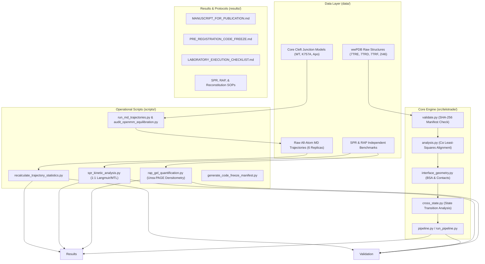

# Software Architecture & System Design (`telomerase-allosteric-switch`)

## 1. System Overview

The `telomerase-allosteric-switch` repository provides an end-to-end computational structural biology and experimental pre-registration framework designed to investigate the allosteric regulation of human telomerase (TERT) by shelterin protein TPP1.

---

## 2. Component Directory Structure

### `src/telotrade/` (Core Bioinformatics Engine)
- **`validate.py`**: Computes SHA-256 cryptographic checksums of raw coordinates against `data_manifest.csv` and validates structure syntax.
- **`analysis.py`**: Handles structure parsing via Gemmi, robust backbone superimpositions, and Cα root-mean-square displacement calculations.
- **`interface_geometry.py`**: Computes Buried Surface Area (BSA) using Shrake-Rupley and FreeSASA algorithms, contact matrices across multiple cutoffs (3.5 Å, 4.0 Å, 4.5 Å), and polar hydrogen bonds.
- **`cross_state.py`**: Analyzes conformational differences between TPP1-bound (`7TRE`), apo-unbound (`7TRD`), closed catalytic (`7TRF`), and free crystal (`2I46`) states.
- **`sequence_mapping.py`**: Provides sequence alignment, canonical residue numbering, and UniProt cross-referencing.
- **`figures.py`**: Generates publication-ready vector figures (`results/figures/`).

### `scripts/` (Automated Analysis & Simulation)
- **`audit_openmm_equilibration.py`**: Runs all-atom molecular dynamics in OpenMM with a 300-step burn-in exclusion window to test equilibration plateau and replica-level statistics.
- **`recalculate_trajectory_statistics.py`**: Directly recalculates mean, SD, SEM, 95% CI, Student's t-test, Welch's t-test, Cohen's $d$, and Hedges' $g$ from raw trajectory CSVs.
- **`spr_kinetic_analysis.py`**: Automated Biacore SPR 1:1 Langmuir kinetic fitting engine with mass transport limitation (MTL) and pre-registered falsification gating.
- **`rap_gel_quantification.py`**: Automated phosphorimager Urea-PAGE densitometry engine applying rolling-ball background subtraction, $3i$ radioactive guanine normalization, and exponential decay processivity fitting.
- **`verify_telin1.py`**: Adversarial coordinate verification script probing chemical anomalies and steric clashes in small-molecule docking models.
- **`generate_code_freeze_manifest.py`**: Computes SHA-256 hashes across all 25 critical files and updates the pre-registration freeze manifest.

### `tests/` (Quality Assurance & Adversarial Challenger Suite)
- **`test_experimental_scripts.py`**: 10 tests verifying the SPR, RAP, and MD trajectory calculation pipelines.
- **`test_ligand_telin1.py`**: Tests verifying the docked Telin-1 complex clashes and inhibitor structure anomalies.
- **`test_adversarial_b2_challenger.py` & `challenger2.py`**: Tests proper rotation matrices ($\det(R) = +1.0$), SVD vs Gemmi superposition invariants, and coordinate sensitivity.
- **`test_adversarial_m1.py` ... `m5.py`**: Tests corrupted CIF files, single-byte hash deviations, non-standard chain IDs, and CLI failure contracts.
- **`e2e/test_tier1_features.py` ... `tier4_scenarios.py`**: Tiered end-to-end pipeline execution tests reproducing all results from scratch.

---

## 3. Data Contracts & Interfaces

1. **Raw Trajectory Timeseries (`data/trajectories/*.csv`)**:
   - `step`: Integer step number (20 to 1,500).
   - `time_ps`: Physical time in picoseconds (0.04 to 3.00 ps).
   - `ca_rmsd_angstrom`: Backbone Cα RMSD relative to initial minimized structure.
   - `y176_q794_dist_angstrom`: Interatomic distance between `Tyr176:OH` and `Gln794:OE1`.
   - `hbond_formed`: Binary indicator ($1$ if distance $\le 3.2\text{ \AA}$, else $0$).
   - `phase`: String tag (`burn_in` for step $\le 300$, else `production`).

2. **SPR Benchmark Dataset (`data/benchmarks/spr_independent_benchmark.csv`)**:
   - `construct`: Construct identifier (`TERT_WT`, `TERT_Lys757A`, `TERT_Lys757R`, `TERT_Glu169A_neg`).
   - `replicate`: Biological replicate index ($1, 2, 3$).
   - `phase`: Sensorgram phase (`association` or `dissociation`).
   - `time_sec`: Sensorgram time in seconds ($0\text{--}180\text{ s}$ for association, $0\text{--}600\text{ s}$ for dissociation).
   - `response_RU`: Surface Plasmon Resonance signal in Response Units.
   - `conc_nM`: Injected analyte concentration in nanomolar.

3. **RAP Benchmark Dataset (`data/benchmarks/rap_independent_benchmark.csv`)**:
   - `construct`: Construct identifier.
   - `replicate`: Replicate index.
   - `repeat_number`: Telomeric hexameric repeat index ($i = 1 \dots 16$).
   - `raw_intensity_minus_tpp1`: Raw phosphorimager pixel count in the absence of TPP1.
   - `raw_intensity_plus_tpp1`: Raw phosphorimager pixel count in the presence of 500 nM TPP1.
   - `background_intensity`: Local lane background intensity.
   - `internal_control_recovery`: Internal radiolabeled recovery control factor.
