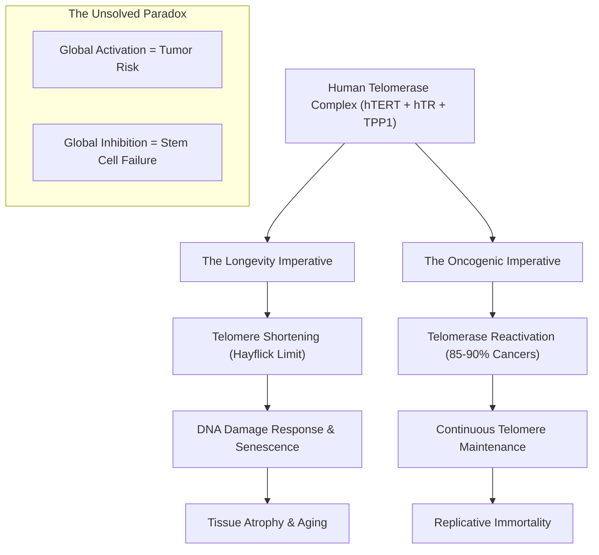
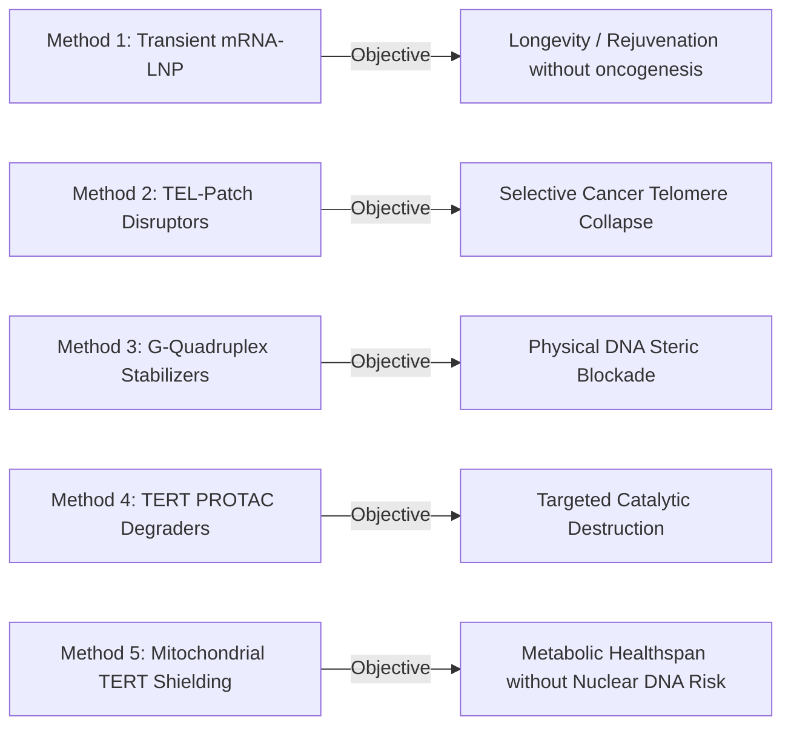

# The Unsolved Frontier: Human Telomerase at the Nexus of Cancer & Longevity

> **Current status — 2026-11-01.** The identifiability analysis in
> [`paper/MANUSCRIPT.md`](../../paper/MANUSCRIPT.md) formalises why several of the open questions
> described here cannot be resolved by processivity measurements alone. Where the two documents
> differ on what is inferable, the manuscript is the current statement.

## Executive Summary

The **Human Telomerase Complex** represents the single greatest molecular paradox in biomedical science:
* **In Longevity**: Progressive telomere erosion is the biological clock dictating cellular senescence, organ failure, and human aging (the Hayflick limit).
* **In Cancer**: Re-activation of telomerase occurs in **85%–90% of all human malignancies**, granting malignant tumors limitless replicative immortality.

For over 25 years, therapeutic intervention has remained stalled by this double-edged sword: **systemic telomerase activation risks malignant transformation**, while **unselective catalytic inhibition damages vital regenerative stem cell niches** (bone marrow, gastrointestinal epithelium).

Using high-resolution Cryo-EM structure **PDB: 7TRE** (Human Telomerase Catalytic Core with Shelterin TPP1), we visualize the machinery in the workspace sidecar and evaluate five distinct structural and pharmacological methodologies designed to decouple longevity enhancement from oncogenesis.

---

---

## 1. Structural Architecture & Active Viewer Scene (`7TRE`)

The rendered structure displays the 3.5 Å Cryo-EM complex of the active human telomerase core engaged with its chromosome-docking partner:

| Domain / Chain | Entity | Residues / Size | Role & Visualized Annotation in Sidecar |
| :--- | :--- | :--- | :--- |
| **Chain A** | **hTERT** (Reverse Transcriptase) | 934 amino acids | Catalytic motor containing fingers, palm, and thumb domains. **Annotated in Red (`s2`)**: Catalytic triad residues **Asp712, Asp868, Asp869**. |
| **Chain B** | **hTR / TER** (Telomerase RNA) | 217 nucleotides | Structural pseudoknot scaffold providing the `3'-CAAUCCCAAUC-5'` template for reverse transcription. |
| **Chain C** | **TPP1** (Shelterin Subunit) | 152 amino acids | The chromosomal bridge that recruits telomerase to telomeres. **Annotated in Cyan (`s3`)**: The **TEL-Patch (`Glu168–Glu171`)**. |
| **Chain D** | **Telomeric DNA** (3' Overhang) | 7 nucleotides | The single-stranded `TTAGGG` repeat substrate being actively elongated. **Annotated in Yellow (`s4`)**. |

---

## 2. Comparing 5 Methodologies to Solve the Paradox

### Method 1: Transient Modified mRNA-LNP Delivery (The Longevity Solution)
* **Mechanism**: Deliver synthetic, modified mRNA (e.g., $N^1$-methylpseudouridine modified) encoding full-length hTERT encapsulated in organ-targeted lipid nanoparticles (LNPs).
* **How It Solves the Paradox**: 
  Unlike viral gene therapy or genomic editing, synthetic mRNA has an intracellular half-life of only **24 to 48 hours**. 
  * In this narrow therapeutic window, telomeres are extended by **1,000 to 1,500 base pairs**, effectively winding back the cellular biological clock by several decades of cell divisions.
  * Because the mRNA is cleared within two days, cells cannot acquire the constitutive, endless replicative potential required to foster tumorigenesis.
* **Current Status**: Preclinical validation demonstrated extended replicative capacity in human fibroblasts, myoblasts, and hematopoietic stem cells without chromosomal aberrations or transformed phenotypes.

### Method 2: Selective TPP1 TEL-Patch Allosteric Disruptors (The Cancer Solution)
* **Mechanism**: Target the interface between hTERT's TEN domain and the shelterin protein TPP1 (specifically residues **Glu168, Glu169, Glu171**, highlighted in cyan in your viewer).
* **How It Solves the Paradox**:
  * Instead of shutting down the catalytic enzyme with toxic nucleoside analogs (which destroy bone marrow and gut lining), a small molecule or stapled peptide blocking the TEL-patch **prevents telomerase from docking onto chromosome ends**.
  * Cancer cells with already critically short telomeres immediately undergo telomeric uncapping and apoptosis, while stem cells with longer telomeres retain reservoir buffer.

### Method 3: Telomeric G-Quadruplex (G4) Chemical Stabilizers
* **Mechanism**: Small molecules (such as CX-5461, BRACO-19, or Pyridostatin) that selectively bind and lock the single-stranded 3' telomeric repeat overhang into planar four-stranded G-quartets stabilized by Hoogsteen hydrogen bonds.
* **How It Solves the Paradox**:
  * Telomerase can only extend single-stranded linear DNA (visualized as Chain D in the viewer).
  * A stable G-quadruplex forms an insurmountable steric barrier, physically terminating telomerase elongation and displacing protective shelterin components (POT1-TPP1), causing synthetic lethality specifically in cancer cells with elevated replication stress.

### Method 4: Targeted Degraders (TERT PROTACs & Molecular Glues)
* **Mechanism**: Designing heterobifunctional proteolysis-targeting chimeras (PROTACs) that link a TERT-binding moiety to a Cereblon (CRBN) or Von Hippel-Lindau (VHL) E3 ubiquitin ligase ligand.
* **How It Solves the Paradox**:
  * Overcomes drug resistance arising from active site mutations.
  * Strips cancer cells of non-canonical TERT oncogenic activities (such as Wnt/$\beta$-catenin co-transcriptional activation and NF-$\kappa$B signaling), which catalytic inhibitors fail to touch.

### Method 5: Uncoupling Mitochondrial TERT from Nuclear Reverse Transcription
* **Mechanism**: Under oxidative stress, a fraction of hTERT translocates to the mitochondrial matrix via an N-terminal mitochondrial targeting sequence, where it preserves mitochondrial DNA integrity, lowers reactive oxygen species (ROS), and suppresses apoptosis.
* **How It Solves the Paradox**:
  * Engineered non-catalytic hTERT peptides or mitochondrial-exclusive TERT constructs impart metabolic resistance and organ preservation (longevity benefit) without performing any nuclear DNA synthesis, eliminating replicative oncogenic risk.

---

## 3. Comparative Evaluation Matrix

| Metric | Method 1: Transient mRNA | Method 2: TEL-Patch Blockers | Method 3: G4 Stabilizers | Method 4: TERT PROTACs | Method 5: Mitochondrial TERT |
| :--- | :--- | :--- | :--- | :--- | :--- |
| **Primary Goal** | **Longevity / Rejuvenation** | **Cancer Therapy** | **Cancer Therapy** | **Cancer Therapy** | **Healthspan / Metabolic** |
| **Oncogenic Risk** | Minimal (rapid mRNA decay) | None (Anti-tumor) | None (Anti-tumor) | None (Anti-tumor) | Negligible (nuclear excluded) |
| **Stem Cell Toxicity** | Beneficial (stem renewal) | Low–Moderate | Moderate | Moderate | None |
| **Structural Target** | Full TERT translation | TPP1 `Glu168–171` patch | Telomeric DNA (Chain D) | Surface lysine residues | Mitochondrial transport |
| **Clinical Readiness** | Phase 1/preclinical LNP | High-throughput screening | Phase 1/2 oncology trials | Discovery / Lead opt. | Academic / Proof of concept |

---

## 4. Conclusion & Next Steps

Resolving the cancer-longevity riddle requires shifting from static global enzyme modulation to **temporally restricted delivery** (transient mRNA pulses for longevity) and **spatial recruitment inhibition** (disrupting the TPP1-TERT interface for cancer). 

The 3D coordinates and annotated functional domains remain live and interactive in the **Biomolecular Structure Viewer**.
